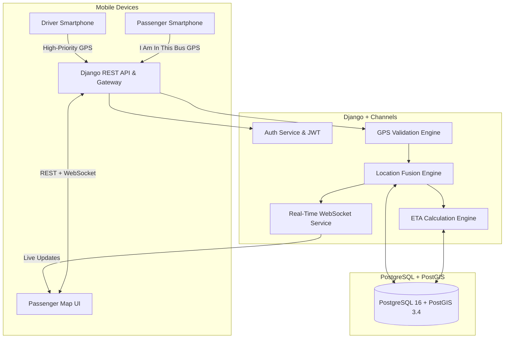

# KKRTC – Where Is My Bus? Architecture Specification

**Version:** 1.0.0  
**Target Region:** Karnataka, India (Initial Route: Ballari ↔ Gangavathi)  
**Primary Platform:** Android (Flutter) + Django REST Backend  

---

## 1. System Overview

KKRTC (Kalyana Karnataka Road Transport Corporation) – Where Is My Bus? is a real-time, hybrid public transport tracking solution designed to provide reliable bus location and arrival estimates without requiring dedicated on-bus GPS hardware.

---

## 2. Core Architectural Principles

1. **Smartphone-First Hybrid Tracking**:
   - **Source A (Driver GPS)**: Primary authoritative tracking stream during an active duty session.
   - **Source B (Passenger GPS)**: Supporting crowdsourced telemetry collected with explicit consent ("I AM IN THIS BUS") and verified boarding.
2. **Clean Architecture (Flutter Mobile)**:
   - Feature-based structure (`authentication`, `passenger`, `driver`, `bus_search`, `live_tracking`, `profile`).
   - Strict separation between Presentation, Domain/Logic, and Data layers.
3. **Robust Backend (Django 5 + PostGIS)**:
   - Spatial queries using PostGIS geographic coordinates (SRID 4326).
   - Real-time updates via Django Channels and WebSockets.
4. **Resilient Failure Handling**:
   - Driver disconnect triggers graceful fallback to crowdsourced passenger fusion.
   - Outlier rejection prevents malicious or erratic coordinate spoofing.
